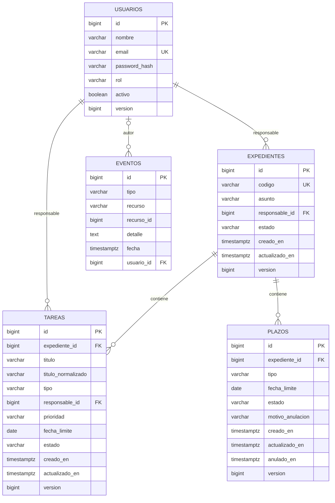

# Modelo relacional del segundo avance

Flyway crea el esquema con `V1__crear_modelo_relacional.sql`, incorpora las restricciones comunes con `V2__reforzar_integridad.sql` y, en PostgreSQL, aplica `db/vendor/postgresql/V3__unicidad_tareas_activas.sql`. Hibernate valida las entidades sin recrear las tablas. H2 ejecuta V1 y V2; la unicidad parcial de V3 se verifica en PostgreSQL real con `docs/verificar-integridad-postgresql.sql`.

Los diagramas actualizados están en `../Diagramas_APF2/01-modelo-logico-v2.png` y `../Diagramas_APF2/02-modelo-fisico-v2.png`. El lógico representa atributos y relaciones sin tipos específicos del motor. El físico añade tipos, nulabilidad, identidad y valores predeterminados; las restricciones e índices completos se detallan en este documento para mantener legibles los diagramas.



## Integridad y trazabilidad

- Las claves primarias usan `BIGINT GENERATED BY DEFAULT AS IDENTITY`.
- El correo de usuario y el código normalizado del expediente son únicos. V2 exige correo en minúsculas y código en mayúsculas, sin espacios exteriores ni valores vacíos. Los CHECK junto con las claves únicas impiden variantes que eludan la normalización mediante SQL directo.
- Expedientes y tareas requieren responsables existentes. Los plazos se controlan mediante su expediente.
- Roles: `ADMINISTRADOR`, `SUPERVISOR`, `RESPONSABLE` y `AUDITOR`.
- Estados de expediente: `ABIERTO`, `CERRADO` y `ARCHIVADO`; de tarea: `PENDIENTE`, `EN_PROGRESO`, `CERRADA` y `CANCELADA`; de plazo: `ACTIVO` y `ANULADO`.
- Las bajas son lógicas para preservar relaciones y auditoría. No se eliminan usuarios referenciados ni eventos históricos.
- `version` detecta escrituras concurrentes. Las operaciones que verifican tareas equivalentes y el estado del expediente utilizan además un bloqueo del expediente dentro de la transacción.
- `titulo_normalizado` es una redundancia controlada: V2 exige que coincida con `UPPER(titulo)`. En PostgreSQL V3 impide dos tareas activas con la misma combinación `(expediente_id, titulo_normalizado, tipo)`, aunque tengan responsables o prioridades diferentes. Una tarea finalizada no participa en esa unicidad.
- Un plazo ACTIVO debe tener `motivo_anulacion` y `anulado_en` nulos. Un plazo ANULADO requiere motivo no vacío y fecha de anulación. El CHECK comprueba explícitamente los nulos para que la lógica de SQL no permita combinaciones incompletas.
- `eventos.usuario_id` guarda al autor autenticado y puede ser nulo en acciones iniciales del sistema. `recurso` y `recurso_id` identifican el objeto auditado; no son una clave foránea polimórfica.
- Los instantes se guardan con zona horaria; las fechas límite son fechas civiles y las reglas usan `America/Lima`.
- Los índices cubren filtros por responsable, estado y fecha límite, además de consultas por expediente y recurso auditado.

## Propiedades físicas y dominios

Todas las columnas son NOT NULL excepto `plazos.motivo_anulacion`, `plazos.anulado_en` y `eventos.usuario_id`. Las cinco claves primarias son BIGINT con `GENERATED BY DEFAULT AS IDENTITY`. `usuarios.activo` tiene DEFAULT TRUE y las cuatro columnas `version` tienen DEFAULT 0. Los demás valores iniciales los aporta la aplicación.

Las cinco claves foráneas conservan las acciones predeterminadas de PostgreSQL, ON UPDATE NO ACTION y ON DELETE NO ACTION, sin cascadas de borrado. El autor de un evento es opcional; las demás relaciones son obligatorias en el lado hijo. Un usuario, expediente u otro padre puede existir sin hijos.

El dominio de prioridad es BAJA, MEDIA o ALTA. Los roles y estados indicados arriba están protegidos por CHECK. `tareas.tipo` y `plazos.tipo` siguen siendo texto de hasta 50 caracteres; no son catálogos administrables. Cada usuario tiene un único rol. No se requieren tablas adicionales para estas reglas actuales.

`eventos.recurso_id` no debe dibujarse como FK: PostgreSQL no verifica mediante ese campo que exista el recurso auditado. Se mantiene esta referencia genérica para la trazabilidad de diferentes clases de objetos. La aplicación es responsable de registrar referencias correctas; la auditoría no implica una relación adicional entre todas las tablas.

| Índice adicional a PK y claves únicas de V1 | Columnas / condición |
|---|---|
| idx_usuarios_rol_activo | rol, activo |
| idx_expedientes_responsable_estado | responsable_id, estado |
| idx_expedientes_estado_creado | estado, creado_en |
| idx_tareas_expediente_estado_titulo | expediente_id, estado, titulo_normalizado |
| idx_tareas_responsable_estado_fecha | responsable_id, estado, fecha_limite |
| idx_tareas_estado_fecha | estado, fecha_limite |
| uk_tareas_activas_equivalentes | UNIQUE (expediente_id, titulo_normalizado, tipo) WHERE estado IN ('PENDIENTE', 'EN_PROGRESO') |
| idx_plazos_expediente_estado | expediente_id, estado |
| idx_plazos_estado_fecha | estado, fecha_limite |
| idx_eventos_fecha | fecha |
| idx_eventos_usuario_fecha | usuario_id, fecha |
| idx_eventos_recurso | recurso, recurso_id |

## Verificación en PostgreSQL

Después de aplicar V1–V3, ejecuta desde PowerShell en la raíz del backend:

```powershell
Get-Content docs/verificar-integridad-postgresql.sql -Raw | docker compose exec -T db sh -c 'exec psql -v ON_ERROR_STOP=1 -U "$POSTGRES_USER" -d "$POSTGRES_DB"'
```

El script verifica las restricciones con filas temporales dentro de una transacción que termina con ROLLBACK. No conserva usuarios, expedientes ni tareas de prueba. Las secuencias de identidad pueden avanzar, lo cual es normal; sus valores no tienen que ser consecutivos.

## Cambios futuros

Después de aplicar una migración a una base persistente, no se modifica su contenido. Los cambios posteriores se incorporan como `V2__...sql`, `V3__...sql`, etc. Así se mantienen los checksums de Flyway y se actualiza la aplicación sin reconstruir la base.
